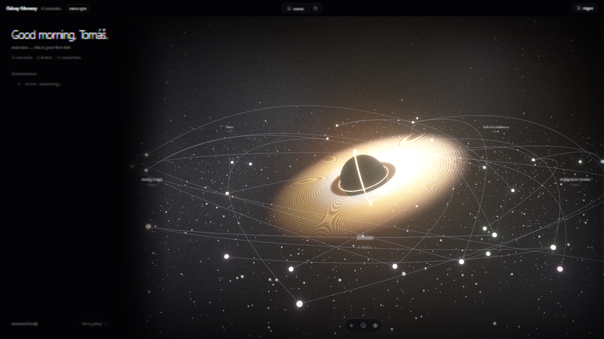

# Galaxy-Memory

[](https://github.com/vestyxdev/Galaxy-Memory/actions/workflows/ci.yml)

Infinite, semantically searchable long-term memory for AI coding agents — plus
an interactive 3D knowledge graph centered on an Interstellar-inspired black
hole. MIT licensed.



## Layout

```
apps/web            React 19 + Vite + Three.js galaxy visualizer + editor UI
packages/mcp-server stdio MCP server — memory tools for AI agents
packages/shared     types, embeddings (openai/ollama/local), [[wikilinks]],
                    ingest pipeline, MemoryBackend interface, Supabase backend
supabase/migrations PostgreSQL + pgvector schema (HNSW, match_memories RPC)
```

npm workspaces. TypeScript strict everywhere; oxlint + oxfmt, never ESLint/Prettier.

## Quickstart (zero config)

```sh
npm install
npm run dev
```

With no env vars the app runs in **Local Demo Mode**, seeded with 30
interconnected memories across 5 clusters. Under `npm run dev`, a Vite
middleware (`/api/local-memories`) bridges the web app to the same JSON file
the MCP server uses (`~/.galaxy-memory/memories.json`) — agent saves appear
live in the galaxy via a 2.5 s poll. Production demo falls back to
LocalStorage. Override the file location with `GALAXY_MEMORY_DB`.

## Supabase mode

1. Create a project, then apply the schema:
   `supabase/migrations/001_init.sql` (SQL editor or `supabase db push`).
2. Copy `.env.example` → `.env.local` and set:

```sh
VITE_SUPABASE_URL=https://<ref>.supabase.co
VITE_SUPABASE_ANON_KEY=<anon-key>
```

3. Embeddings: `OPENAI_API_KEY` (text-embedding-3-small), or
   `EMBEDDING_PROVIDER=ollama` + `OLLAMA_URL` for local `nomic-embed-text`,
   or leave unset for the built-in deterministic embedder.

Note: `VITE_OPENAI_API_KEY` ships the key to the browser — fine for a
self-hosted single-user vault, not for a public deploy.

## MCP server

```sh
npm run build -w @galaxy-memory/shared -w @galaxy-memory/mcp-server
```

Register it in your agent client — click the sync badge in the app's top bar
for a ready-to-paste config with this machine's absolute path, or see
`packages/mcp-server/mcp-config.example.json`:

```json
{
  "mcpServers": {
    "galaxy-memory": {
      "command": "node",
      "args": ["<repo>/packages/mcp-server/dist/index.js"],
      "env": { "SUPABASE_URL": "...", "SUPABASE_SERVICE_ROLE_KEY": "...", "OPENAI_API_KEY": "..." }
    }
  }
}
```

Tools: `search_memory` (hybrid FTS + vector RAG, optional 1-hop neighbors),
`recall` (context-window packing with citations and a token budget),
`save_memory`, `update_memory`, `delete_memory`, `get_memory` (full read),
`get_memory_context`, `list_clusters`, `link_memories`,
`import_markdown` (Obsidian frontmatter + `#tags` + chunked long docs,
content-hash dedup), `export_markdown`, `pin_memory`, `archive_memory`,
`find_duplicates`, `graph_stats` (cluster counts + orphans).
Agent writes run the full pipeline — embed, `[[wikilink]]` explicit edges,
top-5 semantic edges (>0.78 cosine) — with `source: "ai_agent"`. With Supabase
configured, agent saves appear live in the web UI via `postgres_changes`
realtime (the migration adds both tables to the publication).

## UI shortcuts

| Keys                  | Action             |
| --------------------- | ------------------ |
| `N`                   | new memory         |
| `/` or `Ctrl/Cmd+K`   | semantic search    |
| `R`                   | reset camera       |
| `Ctrl/Cmd+Enter`      | save in editor     |
| click a cluster label | fly to that sector |

## Commands

| Command                           | What it does                        |
| --------------------------------- | ----------------------------------- |
| `npm run dev`                     | build shared, then Vite dev server  |
| `npm run build`                   | all packages + web production build |
| `npm run lint` / `npm run format` | oxlint / oxfmt                      |
| `npm run typecheck`               | `tsc -b` over the whole workspace   |
| `npm run mcp`                     | build + run the MCP server          |

A `justfile` mirrors these (`just dev`, `just check`) and `lefthook.yml`
gates `git push` on them.

## Notes

- `zod` is pinned to 3.x because `@modelcontextprotocol/sdk` vendors it via
  `zod-to-json-schema`; `npm audit` reports a high-severity finding fixed only
  in zod 4.x — the vulnerable copy exists in the SDK's tree regardless, and the
  exposed surface is tool-arg validation from a local stdio client.
